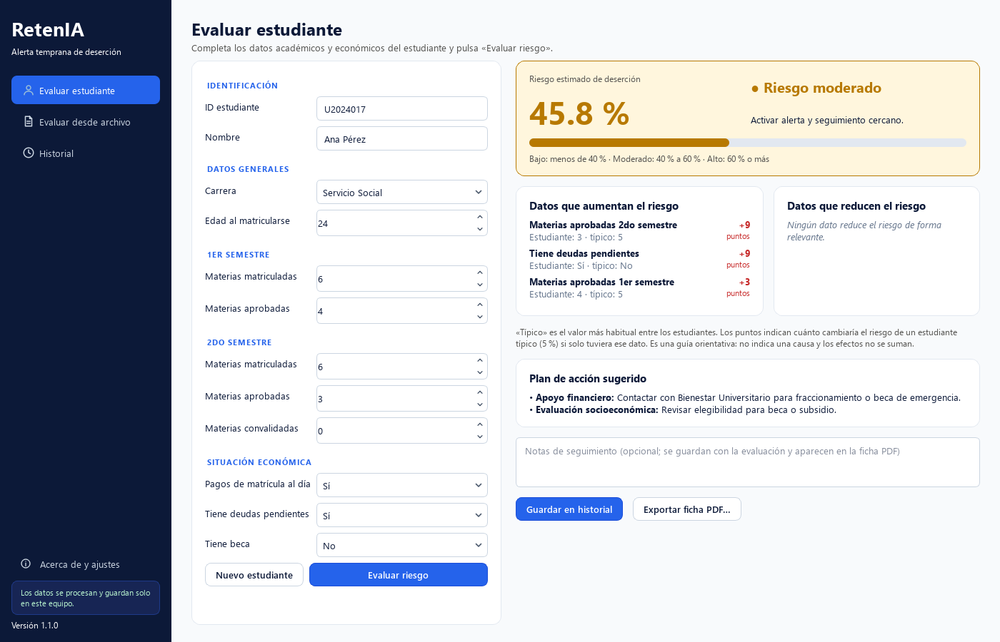
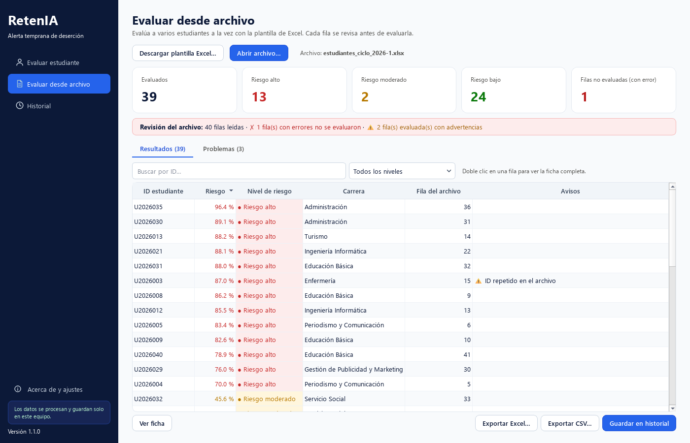
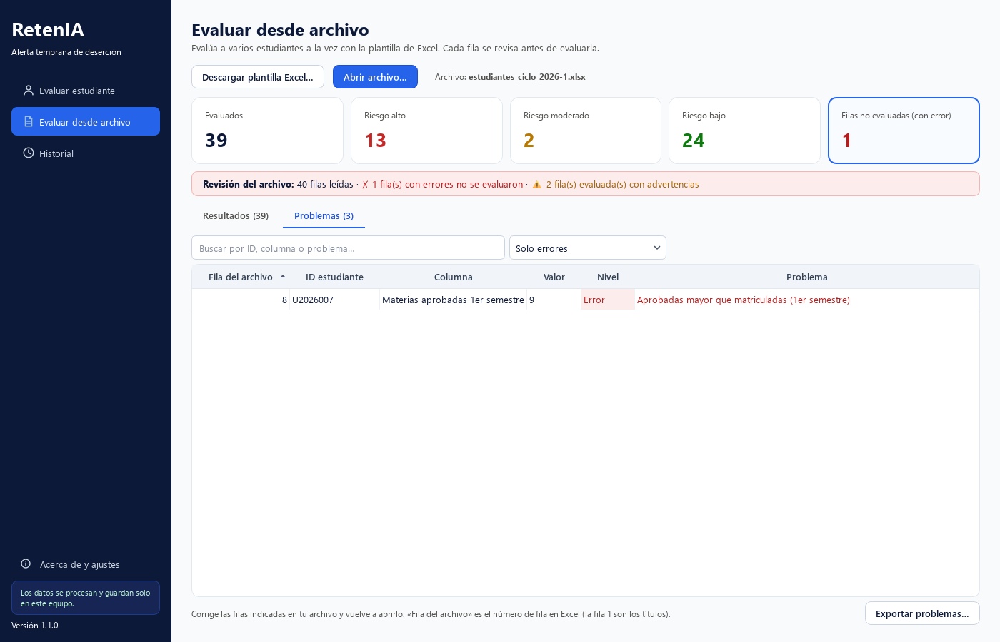
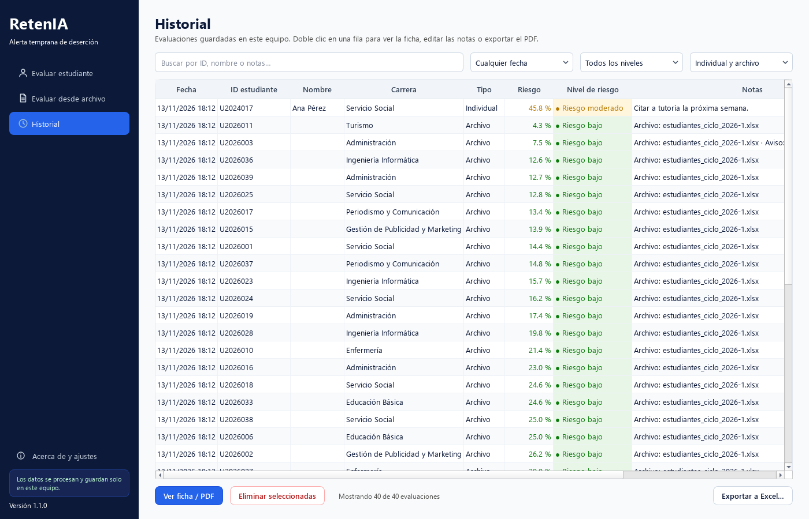
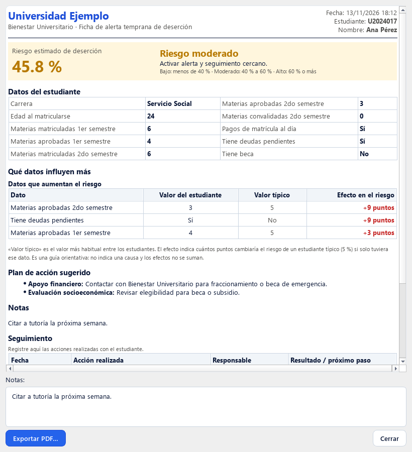

<p align="center">
  
</p>

<h1 align="center">RetenIA</h1>

<p align="center">
  <b>Alerta temprana de deserción universitaria</b> — app de escritorio para Windows que estima el riesgo
  de abandono de cada estudiante con un modelo de Machine Learning, sin conexión a internet.
</p>

<p align="center">
  <a href="https://github.com/Kevin-VG/retenia/releases/latest"><b>⬇ Descargar para Windows</b></a> ·
  <a href="MODEL_CARD.md">Ficha del modelo</a>
</p>



## Qué hace

| Función | Descripción |
|---|---|
| **Evaluar estudiante** | Formulario con 10 datos clave → riesgo estimado de deserción, nivel (🟢 bajo · 🟡 moderado · 🔴 alto), qué datos suben o bajan el riesgo y plan de acción sugerido. |
| **Evaluar desde archivo** | Plantilla Excel en español con listas desplegables y ayuda en cada celda. Abre o arrastra el archivo → revisión fila por fila (errores y advertencias), tabla ordenada por riesgo, filtros, exportación a Excel/CSV. |
| **Historial** | Guarda evaluaciones en una base local (SQLite) con notas de seguimiento. Búsqueda por ID, nombre o notas y filtro por fecha. |
| **Ficha PDF** | Informe por estudiante con espacio de seguimiento y firma. El nombre de la institución, el área y el responsable se configuran en *Acerca de y ajustes*. |

**Privacidad:** todo se calcula en el equipo. Los datos de estudiantes nunca salen de la computadora;
el historial vive en `%APPDATA%\RetenIA\historial.db`.

## Instalación

1. Ve a [**Releases**](https://github.com/Kevin-VG/retenia/releases/latest).
2. Descarga una de las dos opciones:
   - `RetenIA-x.y.z-Setup.exe` — **instalador** (recomendado). No pide permisos de administrador.
   - `RetenIA-x.y.z-win64-portable.zip` — **portable**: descomprimir y abrir `RetenIA.exe`.
3. Requisitos: Windows 10 u 11 de 64 bits. No necesita Python.

> **Aviso de SmartScreen:** como el ejecutable no tiene firma digital comercial, Windows puede mostrar
> «Windows protegió su PC». Pulsa **Más información → Ejecutar de todas formas**. Puedes comprobar la
> integridad de la descarga con `SHA256SUMS.txt`.

## El modelo

- **Algoritmo:** Gradient Boosting (scikit-learn 1.9.1), elegido por F1 en validación cruzada entre 4 modelos.
- **Datos:** 4,424 estudiantes del dataset [UCI #697](https://archive.ics.uci.edu/dataset/697/predict+students+dropout+and+academic+success) (CC BY 4.0).
- **Rendimiento en prueba (885 estudiantes, umbral 0.40):** F1 0.827 · Recall 83.1 % · Precision 82.2 % · ROC-AUC 0.934.
- **Semáforo:** 🟢 < 40 % · 🟡 40–60 % · 🔴 ≥ 60 %.

Limitaciones, uso responsable y detalles: [MODEL_CARD.md](MODEL_CARD.md).

Al iniciar, la app comprueba que el modelo se guardó con la misma versión de scikit-learn que la instalada;
si no coincide, avisa en vez de dar predicciones poco fiables.

## Capturas

| Evaluar desde archivo | Revisión de problemas |
|---|---|
|  |  |

| Historial | Ficha |
|---|---|
|  |  |

## Evaluar desde archivo

**Plantilla:** *Evaluar desde archivo → Descargar plantilla Excel*. Incluye:

- **Instrucciones:** pasos para completarla y un ejemplo de fila completa.
- **Estudiantes:** una fila por estudiante. Títulos en español; las columnas azules (con `*`) son obligatorias
  y las grises opcionales. Al seleccionar una celda, Excel muestra qué escribir; las columnas de opciones
  (Carrera, Sí/No, Turno, Género, Estado civil) tienen lista desplegable y Excel avisa si el valor no es válido.
- **Valores válidos:** significado, obligatoriedad, valores permitidos, rango habitual y ejemplo de cada columna.

**Columnas obligatorias (10):** las mismas del formulario individual (carrera, edad, materias matriculadas y
aprobadas por semestre, convalidadas del 2do semestre, pagos al día, deudas y beca). Las **opcionales**
(promedios, evaluaciones, nota de admisión, turno, género…) mejoran la estimación; si faltan o están vacías
se usa el valor típico (mediana), igual que en el formulario. También se acepta un CSV (`,` o `;`, UTF-8 o
ANSI de Excel, decimales con punto o coma) con los mismos títulos, y el formato completo anterior de 36
columnas con los nombres originales del dataset.

**Resultado real (opcional):** una columna `Abandonó` (Sí/No) —o `dropout` (1/0) o `Target`— hace que la app
compare sus alertas con lo ocurrido: cuántos abandonos detectó, precisión de las alertas, exactitud, F1 y AUC.

**Revisión fila por fila.** Al cargar el archivo, cada fila se revisa y la pestaña *Problemas* indica la
fila del archivo, la columna, el valor y qué corregir. Se puede exportar.

| Nivel | Casos | Qué pasa con la fila |
|---|---|---|
| ✗ **Error** | dato obligatorio vacío, texto no reconocido (carrera inexistente, «Tal vez» en un Sí/No), decimal donde va un entero, valor fuera del rango permitido (nota > 20, edad negativa…), aprobadas o convalidadas mayores que matriculadas | **No se evalúa** |
| ⚠ **Advertencia** | código no reconocido, valor poco habitual, promedio > 0 sin aprobadas, ID repetido | Se evalúa, con aviso en la columna *Avisos* |

Si faltan columnas obligatorias, la app las lista todas y no carga el archivo.

## Desarrollo

```powershell
git clone https://github.com/Kevin-VG/retenia.git
cd retenia
py -3.14 -m venv .venv
.venv\Scripts\activate
pip install -r requirements-dev.txt

python -m app.main          # ejecutar la app
python -m pytest            # pruebas (modelo, servicios, interfaz)
```

### Estructura

```
app/
├── main.py              arranque (splash, carga del modelo, traducción de Qt)
├── core/                lógica sin interfaz: variables, semáforo, factores, lotes, métricas
├── services/            modelo, historial (SQLite), plantilla Excel, ficha HTML/PDF, preferencias
├── ui/                  ventana y vistas en PySide6
└── resources/
    ├── model/
    │   ├── pipeline_ganador.joblib   el modelo, tal cual
    │   └── config.json               umbral, medianas, rangos del formulario, métricas
    └── estilos e iconos
tools/generar_icono.py
tests/                   pytest (tests/datos: archivo de prueba en el formato completo de 36 columnas)
packaging/               PyInstaller (.spec) e Inno Setup (.iss)
.github/workflows/       CI y publicación de Releases
```

### Cambiar el modelo

1. Reemplaza `app/resources/model/pipeline_ganador.joblib` por el nuevo archivo. Debe ser un `Pipeline`
   de scikit-learn que reciba las 36 columnas del dataset y tenga `predict_proba`.
2. Si cambia el umbral u otros valores, edita `app/resources/model/config.json`.
3. Ejecuta `python -m pytest`. Las pruebas de `tests/test_modelo.py` fallarán a propósito, porque guardan
   las probabilidades de referencia del modelo anterior: actualiza esos valores.

**No actualices scikit-learn, NumPy ni pandas** en `requirements.txt` sin volver a guardar el modelo con esas versiones.

### Publicar una versión

1. Cambia `__version__` en `app/__init__.py` (por ejemplo `1.1.0`).
2. `git commit -am "chore: v1.1.0" && git tag v1.1.0 && git push origin main v1.1.0`

GitHub Actions ejecuta las pruebas, compila con PyInstaller, comprueba el ejecutable con `--autoprueba`,
crea el instalador con Inno Setup y publica todo en Releases.

Para compilar en local: `pyinstaller packaging/retenia.spec --noconfirm` (genera `dist/RetenIA/`) y, con
[Inno Setup 6](https://jrsoftware.org/isdl.php) instalado, `iscc packaging/installer.iss`.

## Créditos

- Proyecto de Sistemas Inteligentes y Machine Learning — UPN.
- Dataset: V. Realinho, M. Vieira Martins, J. Machado, L. Baptista (2021). *Predict Students' Dropout and
  Academic Success*. UCI Machine Learning Repository. CC BY 4.0.
- Interfaz con [Qt for Python](https://doc.qt.io/qtforpython-6/) (LGPL v3).

Licencia del código: [MIT](LICENSE).
